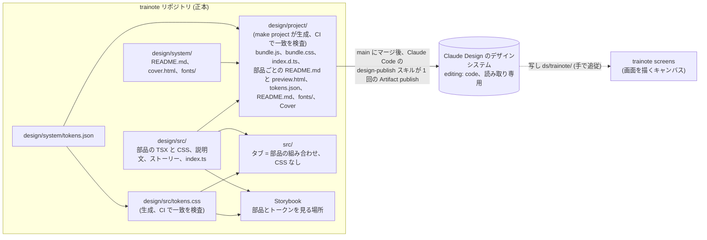

# デザインシステムの運用

trainote の見た目は 1 つのデザインシステム (トークンと部品) だけで組む。アプリは CSS を 1 行も書かず、タブは部品の組み合わせだけで書く。この文書は、そのデザインシステムをどこで育て、どう見て、どう検査し、どうやって Claude Design (claude.ai のアーティファクト) に届け続けるかを決めたもの。2026-11-01 に合意した。

## 正本と写し

- 正本はこのリポジトリの `design/`。トークンは `design/system/tokens.json`、ブランドブック (README.md) と表紙とアイコンフォントも `design/system/`、部品は `design/src/` の TSX と CSS、部品の説明は隣の `<部品名>.md`、見本は Storybook のストーリー。公開する部品の一覧は `design/src/index.ts`。
- Claude Design 側のデザインシステム (https://claude.ai/artifact/DsCPBeo51tExs5wGcYXe8k) は公開先で、正本の写しである。中身は `project/` 配下のファイル一式 (tokens.json、components/bundle.js、bundle.css、index.d.ts、部品ごとの README.md と preview.html) で、`make project` が `design/project/` に生成したものをそのまま送る (`scripts/project.ts`: bundle.js は Vite の IIFE ビルド、index.d.ts は tsc の宣言を 1 つに束ねたもの、preview.html はストーリーの args から書く。カードの枠 (横並び、grouped の背景、文字サイズ、controlled な部品) はストーリーの `parameters.card` に 1 度だけ書き、Storybook の decorator と preview.html が同じものを読む。ストーリー側の `render` や `decorators` はカードに届かないのでビルドが拒む)。index に `editing: code` を入れてページを読み取り専用にし、ページ側の編集で写しがずれることをなくす。
- 画面のアーティファクト (`trainote screens`、https://claude.ai/artifact/2uZYx9fL9R1WBsEFD8jhHB) は、公開したデザインシステムの部品で画面を描く場所。こちらは編集してよい。

2026-10 までは逆向き (アーティファクトが正、`design/system/` に手で写し、さらに `src/components/` に手で TSX に起こす) だった。写すたびに黙ってずれ、アプリに固有の CSS が増えたので向きを変えた。アーティファクトから写した bundle と preview は 2026-11-01 に消し、`design/project/` が置き換えた。`design/system/` に残るのは正本側のもの (tokens.json、README.md、cover.html、fonts/) と、まだ移植していない Bubble、Segmented、Stat の説明文と旧プレビューだけ。

## 流れ

1. 変える。部品やトークンを `design/` で直す PR を出す。Storybook で見る (`make storybook`、http://localhost:6006)。
2. 検査する (CI、`make check`)。
   - `design/src/tokens.css` が `tokens.json` から生成したものと一致する (`tokens:check`)。
   - `design/project/` が `make project` の出力と一致する (`design:project:check`)。部品に説明文かストーリーが無ければビルドが落ちる。
   - Storybook がビルドできる (`storybook:build`)。
   - `src/` に `.css` が無く、`src/` の JSX に `className` が無い (`design:check`)。部品の外にクラスは存在しない。
3. 公開する。main にマージしたあと、Claude Code のセッションで「デザインを公開して」。手順はスキル `design-publish` (yamat47/github-toolkit v1.12.0 から。`.claude/skills/` に入れてある) に固定してあり、`design/publish.json` (公開先、フォルダ、検査コマンド、写しを持つアーティファクト) を読んで動く。スキルがやること:
   1. HEAD が push 済みで `design/project/` に差分が無く、`make project-check` が通ることを確かめる。公開は commit を記録するので、作業中の木からは公開しない。
   2. アーティファクトの index (`project/design-system.json`) を読み、`lastChange.via` (`GitHub · yamat47/trainote@<sha>`) の sha を基準にする。基準が無い (最初の公開、ページで保存された) ときは全部を送り、`design/project/` に無い部品や README をアーティファクトから消す (ページが作る api/ と manifest.json、アップロードされた assets/ には触れない)。
   3. `git diff --name-status <sha> HEAD -- design/project` で、送るファイルと消すファイルを決める。差分が無ければ何も書かずに終わる。
   4. 1 回の publish で送る。index は同じ呼び出しで最後に書く: `editing: code`、`lastChange` に誰が・いつ・どのコミットから。tokens.css もこちらで作って送る (`design/project/tokens.css`。コードから保たれるページはファイルを書かないので、ページが作る形をこちらで出す)。api/ のカードと manifest.json はページが作る。
   5. 公開したファイル一覧を読み戻し、`design/project/` とサイズを突き合わせる。
   6. 画面のアーティファクトが持つデザインシステムの写し (`ds/trainote/`) が古いかを報告する。更新は頼んだときだけ: 画面は Stat、Segmented、Bubble をまだ使っていて、新しい bundle にはそれらが無い。
4. ずれに気づく。CI からアーティファクトに書く API は無いので、公開は人が言う。代わりに、trainote の作業を始めるときは `design-publish` の status (上の 1 から 3 だけ、書き込みなし) で index の `lastChange` と main を比べ、`design/` に未公開の差分があれば先に公開する。

## 最初の公開

2026-11-01、`yamat47/trainote@2991250` から版 13 (1793530634-aec3) として公開した。送ったのは `design/project/` の 39 ファイル、消したのはアーティファクトにだけ残っていた Bubble、Segmented、Stat の README と preview。読み戻した一覧は 39 ファイルともサイズが一致し、index は `editing: code` と上の `lastChange` を持つ。tokens.css はページが前に作ったものとバイト単位で同じだった。画面のアーティファクトの写し (`ds/trainote/`) は bundle.js と bundle.css が古いままで、Stat、Segmented、Bubble を移植するまでそのままにする。スキルはこの回のあとに入れたので、この回は手順を手でなぞった。

## 部品の増やし方

アプリに CSS を書きたくなったら、それはデザインシステムに部品が足りない印。`design/src/` に部品を足し、README と ストーリーを書き、タブはその部品を使う。アプリ側に残していた CSS から起こした部品は次のとおり (2026-11-01 に実装):

| アプリ側にあったもの                                                           | 部品                                   |
| ------------------------------------------------------------------------------ | -------------------------------------- |
| 画面の殻 (safe area、本文、下の TabBar、plain / grouped の背景)、body の初期化 | Screen と base CSS                     |
| 週の文、Claude の一言、単独のエラー行                                          | Text (iOS のテキストスタイル名と tone) |
| 行の直下のエラー行                                                             | Row の `error` prop                    |
| 構造化プレビューの浮いたブロック                                               | Inset                                  |
| ボタンの行 (右寄せ、prominent が伸びる、下のエラー行)                          | Actions                                |
| 見出しつきの plain なリスト                                                    | List                                   |
| 折り返しで伸びる入力欄                                                         | Field に取り込む                       |
| Mark の読み上げ文字、Week の ul/li                                             | Mark と Week で直す                    |
| アイコン                                                                       | Icon を公開する                        |

アーティファクトから移した説明文には、まだ移植していない props が残っている (Button の `tinted`、`destructive`、`bold`、`block`、Field の `label`、`numeric`、`unit`、Row の `mark`)。Weight と Coach を作るときに、使う部品から順に TSX と説明文を揃える。

## 進み具合

| 段階 | 内容                                                                                                             | 状態                                                |
| ---- | ---------------------------------------------------------------------------------------------------------------- | --------------------------------------------------- |
| 1    | 部品を `design/src/` に移し、Storybook (部品、トークンのページ、ライトとダークの切替) を入れる                   | 済 (2026-11-01)                                     |
| 2    | 上の表の部品を足し、タブを部品だけで書き直し、アプリの CSS を 0 行にして検査を入れる                             | 済 (2026-11-01)                                     |
| 3    | `design/project/` のビルドと最初の公開、`design-publish` スキル (github-toolkit)、`design/screens/` の扱いの整理 | 済 (2026-11-01)。写し `ds/trainote/` の更新は移植後 |
