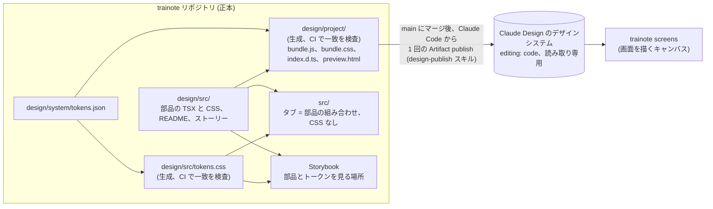

# デザインシステムの運用

trainote の見た目は 1 つのデザインシステム (トークンと部品) だけで組む。アプリは CSS を 1 行も書かず、タブは部品の組み合わせだけで書く。この文書は、そのデザインシステムをどこで育て、どう見て、どう検査し、どうやって Claude Design (claude.ai のアーティファクト) に届け続けるかを決めたもの。2026-11-01 に合意した。

## 正本と写し

- 正本はこのリポジトリの `design/`。トークンは `design/system/tokens.json`、部品は `design/src/` の TSX と CSS、部品の説明は隣の `<部品名>.md`、見本は Storybook のストーリー。
- Claude Design 側のデザインシステム (https://claude.ai/artifact/DsCPBeo51tExs5wGcYXe8k) は公開先で、正本の写しである。中身は `project/` 配下のファイル一式 (tokens.json、components/bundle.js、bundle.css、index.d.ts、部品ごとの README.md と preview.html) で、リポジトリのビルドが生成したものをそのまま送る。index に `editing: code` を入れてページを読み取り専用にし、ページ側の編集で写しがずれることをなくす。
- 画面のアーティファクト (`trainote screens`、https://claude.ai/artifact/2uZYx9fL9R1WBsEFD8jhHB) は、公開したデザインシステムの部品で画面を描く場所。こちらは編集してよい。

2026-10 までは逆向き (アーティファクトが正、`design/system/` に手で写し、さらに `src/components/` に手で TSX に起こす) だった。写すたびに黙ってずれ、アプリに固有の CSS が増えたので向きを変えた。`design/system/` はアーティファクトから最後に取り込んだ写し (版 1793103317-d855) で、`tokens.json` 以外は生成物 `design/project/` に置き換わる予定。

## 流れ

1. 変える。部品やトークンを `design/` で直す PR を出す。Storybook で見る (`make storybook`、http://localhost:6006)。
2. 検査する (CI、`make check`)。
   - `design/src/tokens.css` が `tokens.json` から生成したものと一致する (`tokens:check`)。
   - `design/project/` がビルドしたものと一致する (予定)。
   - Storybook がビルドできる (`storybook:build`)。
   - `src/` に `.css` が無く、`src/` の JSX に `className` が無い (`design:check`)。部品の外にクラスは存在しない。
3. 公開する。main にマージしたあと、Claude Code のセッションで「デザインを公開して」。手順はスキル `design-publish` に固定する (yamat47/github-toolkit に置き、`gh skill install` で入れる。いまは未作成)。スキルがやること:
   1. アーティファクトの index (`project/design-system.json`) を読み、`lastChange.via` (`GitHub · yamat47/trainote@<sha>`) と main の HEAD を比べる。
   2. `design/project/` のうち変わったファイルだけを 1 回の publish で送る。
   3. 最後に index を書く: `editing: code`、`lastChange` に誰が・いつ・どのコミットから。ページは受け取った tokens.json から tokens.css と api/ のカードを作り直す。
   4. 公開したファイル一覧を読み戻し、`design/project/` と突き合わせる。
   5. 画面のアーティファクトが持つデザインシステムの写し (`ds/trainote/`) が追従したかを確かめる。追従しなければ同じファイルで更新する。
4. ずれに気づく。CI からアーティファクトに書く API は無いので、公開は人が言う。代わりに、trainote の作業を始めるときは index の `lastChange` と main を比べ、`design/` に未公開の差分があれば先に公開する。

## 部品の増やし方

アプリに CSS を書きたくなったら、それはデザインシステムに部品が足りない印。`design/src/` に部品を足し、README と ストーリーを書き、タブはその部品を使う。アプリ側に残していた CSS から起こした部品は次のとおり (2026-11-01 に実装):

| アプリ側にあったもの                                                           | 部品                                   |
| ------------------------------------------------------------------------------ | -------------------------------------- |
| 画面の殻 (safe area、本文、下の TabBar、plain / grouped の背景)、body の初期化 | Screen と base CSS                     |
| 週の文、Claude の一言、単独のエラー行                                          | Text (iOS のテキストスタイル名と tone) |
| 行の直下のエラー行                                                             | Row の `error` prop                    |
| 構造化プレビューの浮いたブロック                                               | Inset                                  |
| ボタンの行 (右寄せ、prominent が伸びる、下のエラー行)                          | Actions                                |
| 見出しつきの plain なリスト                                                    | List                                   |
| 折り返しで伸びる入力欄                                                         | Field に取り込む                       |
| Mark の読み上げ文字、Week の ul/li                                             | Mark と Week で直す                    |
| アイコン                                                                       | Icon を公開する                        |

アーティファクトから移した説明文には、まだ移植していない props が残っている (Button の `tinted`、`destructive`、`bold`、`block`、Field の `label`、`numeric`、`unit`、Row の `mark`)。Weight と Coach を作るときに、使う部品から順に TSX と説明文を揃える。

## 進み具合

| 段階 | 内容                                                                                                             | 状態            |
| ---- | ---------------------------------------------------------------------------------------------------------------- | --------------- |
| 1    | 部品を `design/src/` に移し、Storybook (部品、トークンのページ、ライトとダークの切替) を入れる                   | この PR         |
| 2    | 上の表の部品を足し、タブを部品だけで書き直し、アプリの CSS を 0 行にして検査を入れる                             | 済 (2026-11-01) |
| 3    | `design/project/` のビルドと最初の公開、`design-publish` スキル (github-toolkit)、`design/screens/` の扱いの整理 | 未着手          |
